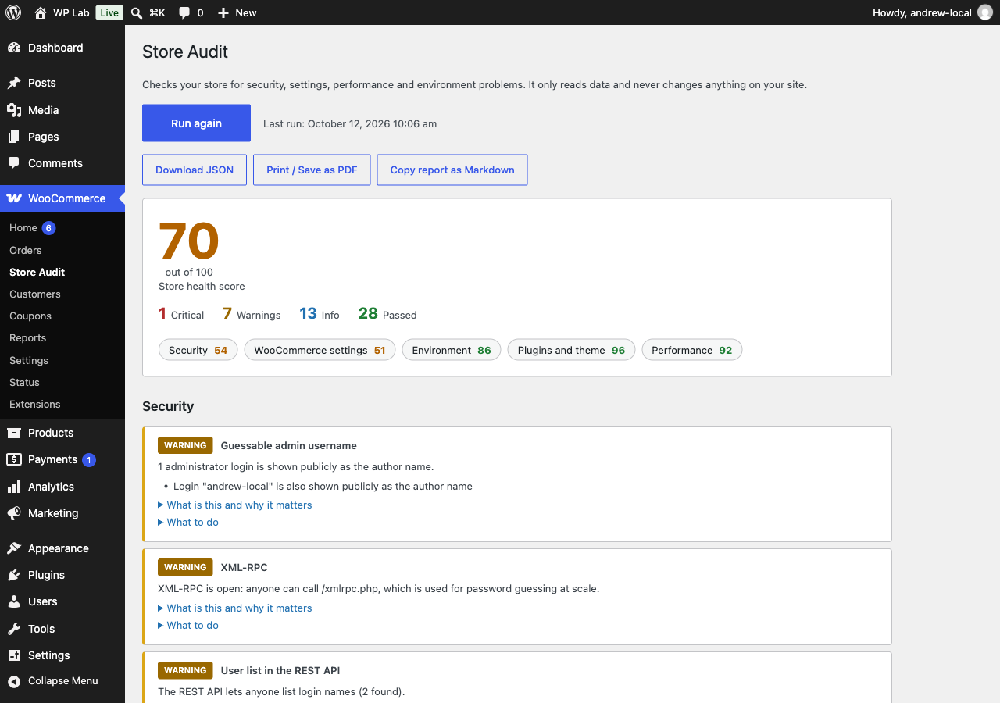

# Store Audit for WooCommerce

One button, read-only audit of your WooCommerce store: a score, plain-language findings and a one-line fix for each.



Store Audit runs 49 checks in five sections and gives you a score from 0 to 100 with a breakdown per section. Every finding says what it is, why it matters and what to do. It never changes anything on your site.

It runs one check per request, so it works on cheap shared hosting. It is for store owners who want to know what is wrong before paying anyone, and for developers and agencies doing a first look at a client store.

Requires WordPress 6.6+, PHP 8.1+, WooCommerce 9.0+. Tested up to WordPress 7.1 and WooCommerce 11.2.

## What it checks

| Section | Examples |
| --- | --- |
| Security | Exposed `.git` and `.env` files, `wp-config.php` exposure, backups in public folders, uploads folder listing, guessable admin username, number and activity of administrators, user list in the REST API, XML-RPC, card-testing protection |
| WooCommerce settings | Cart, checkout and account pages, terms page, guest checkout, tax rates, shipping zones, payment gateways in test mode, webhooks, REST API keys, negative stock, abandoned orders, HPOS |
| Environment | PHP, WordPress and WooCommerce versions, HTTPS, memory limit, execution time, `WP_DEBUG`, file editor, cron, persistent object cache |
| Plugins and theme | Pending updates, abandoned or closed plugins, inactive plugins, must-use plugins, duplicate-purpose plugins, child theme and theme edits |
| Performance | Autoloaded options, expired transients, revisions, database table sizes, catalog size, active plugin count, Heartbeat, image quality and format |

Exports: download JSON, print or save as PDF, copy as Markdown. A Dashboard widget shows the score and the top 3 problems.

## Privacy

No data about your store leaves your site.

- The only outside call is to the public WordPress.org plugin directory API (`api.wordpress.org`). It receives plugin and theme slugs so the audit can tell whether a plugin is closed or abandoned. Answers are cached for 12 hours.
- The security checks request the site's own public URLs from the site itself, to test what a visitor can see (for example whether `wp-config.php` or `.git` is reachable).

## Install

From a zip: download the release zip, then Plugins > Add New > Upload Plugin, activate, and open WooCommerce > Store Audit.

From source:

```bash
git clone https://github.com/andrewrozumny/store-audit-for-woocommerce.git
cd store-audit-for-woocommerce
bash bin/build-zip.sh
```

Then install `dist/store-audit-for-woocommerce-<version>.zip`. The plugin has no runtime dependencies, so you can also copy the folder straight into `wp-content/plugins/`.

## WP-CLI

```bash
wp store-audit run                    # table, default
wp store-audit run --format=json
wp store-audit run --format=markdown
```

## Extending

Add your own checks with the `store_audit_checks` filter. A check is a class implementing `StoreAudit\Checks\CheckInterface`.

Put the class in its own file, and load that file inside the filter callback. The callback only runs when Store Audit is active, so your plugin never breaks when Store Audit is switched off or removed (a class that extends `AbstractCheck` cannot be declared without it).

`class-my-min-order-check.php`:

```php
use StoreAudit\Checks\AbstractCheck;
use StoreAudit\Checks\Section;
use StoreAudit\Result;

final class My_Min_Order_Check extends AbstractCheck {
	public function id(): string {
		return 'woocommerce_my_min_order';
	}
	public function section(): string {
		return Section::WOOCOMMERCE;
	}
	public function title(): string {
		return 'Minimum order amount';
	}
	public function explanation(): string {
		return 'A minimum order amount keeps tiny, unprofitable orders out.';
	}
	public function fix_hint(): string {
		return 'Set a minimum order value in your checkout rules.';
	}
	public function run(): Result {
		return get_option( 'my_min_order' )
			? Result::ok( 'A minimum order amount is set.' )
			: Result::warning( 'No minimum order amount is set.' );
	}
}
```

Your plugin's main file:

```php
add_filter(
	'store_audit_checks',
	static function ( array $checks ): array {
		require_once __DIR__ . '/class-my-min-order-check.php';
		$checks[] = new My_Min_Order_Check();
		return $checks;
	}
);
```

Checks must be read-only. An id must match `^[a-z0-9_]+$` (lower-case letters, digits and underscores), must be unique, and should start with the section id. The section must be one of `environment`, `plugins`, `woocommerce`, `security` or `performance` (the `Section` constants). A check with another id or section, or with an id that is already taken, is left out and reported with `_doing_it_wrong()` when `WP_DEBUG` is on.

## Development

```bash
composer install
composer lint        # PHPCS (WordPress Coding Standards)
composer analyse     # PHPStan
composer test        # PHPUnit unit suite
bash bin/gates.sh    # all quality gates in order
bash bin/build-zip.sh  # builds dist/store-audit-for-woocommerce-<version>.zip
```

## License

GPL-2.0-or-later. See [license](https://www.gnu.org/licenses/gpl-2.0.html).

Author: Andrew Rozumny, [helpmybiz.org](https://helpmybiz.org).
