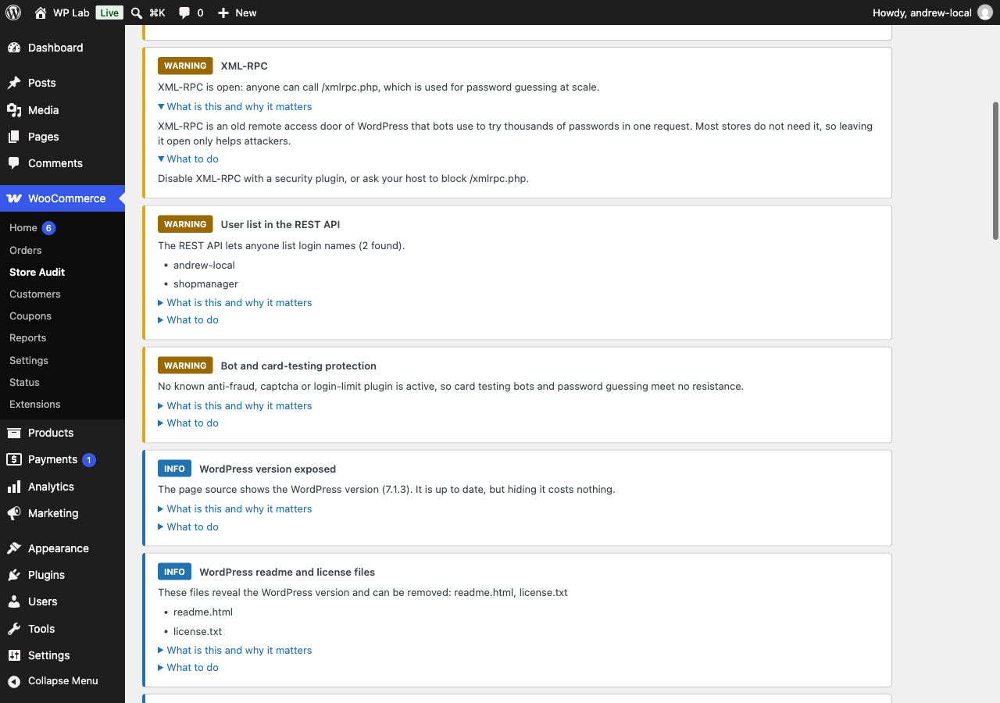
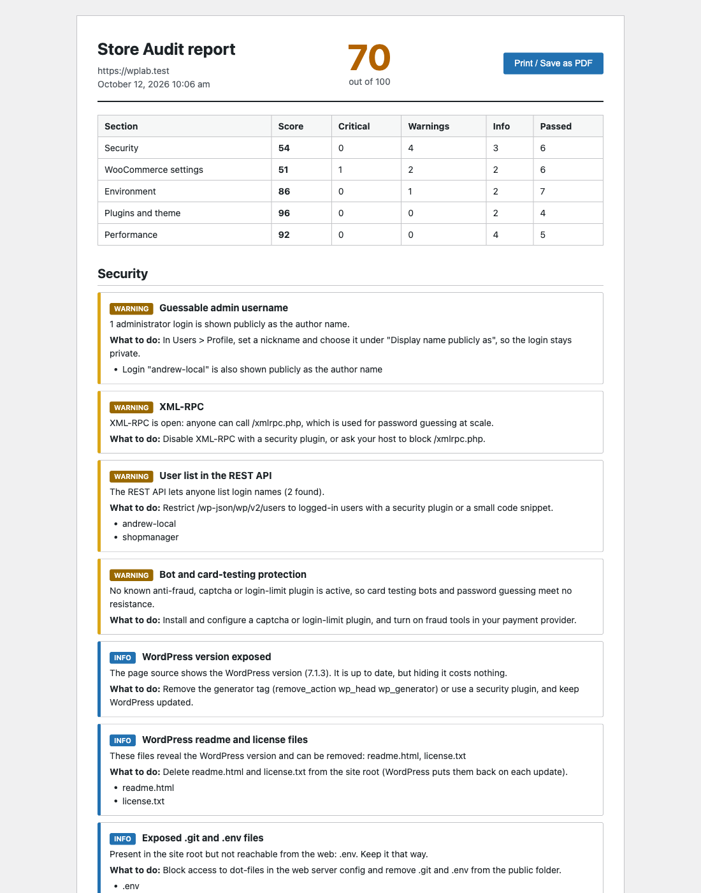

# Store Audit for WooCommerce: find out what is wrong with your store

Store Audit is a free WordPress plugin that checks your WooCommerce store with one button. You get a score from 0 to 100 and a list of findings, each explained in plain language with one line on what to do. It only reads. It never changes anything on your site.

It is for store owners who want to know what is wrong before paying anyone. Run the free audit, send me the report, and I will quote the fix. You get a fixed price for exactly the problems your store has, not a guess.

## What you get

- 49 checks across security, WooCommerce settings, environment, plugins and theme, and performance
- A score from 0 to 100 with a breakdown per section
- Plain-language explanation and a one-line fix for every finding
- Works on cheap hosting: one check per request, no timeouts
- Export: download JSON, print or save as PDF, copy as Markdown
- Dashboard widget with your score and the top 3 problems
- WP-CLI: `wp store-audit run --format=table|json|markdown`
- No data leaves your site, except a public lookup of plugin names in the WordPress.org directory to spot abandoned plugins

## Send me your report

Run the audit, copy the report, and send it to me. I will tell you what matters, what can wait, and what the fix costs.

[Send me your report](https://helpmybiz.org)

## Links

- Source: https://github.com/andrewrozumny/store-audit-for-woocommerce
- WordPress.org: https://wordpress.org/plugins/store-audit-for-woocommerce/
